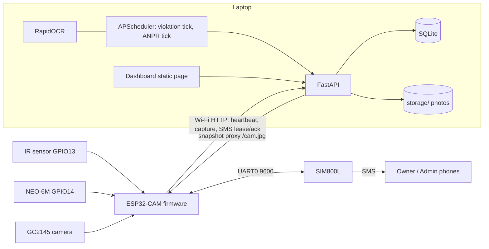
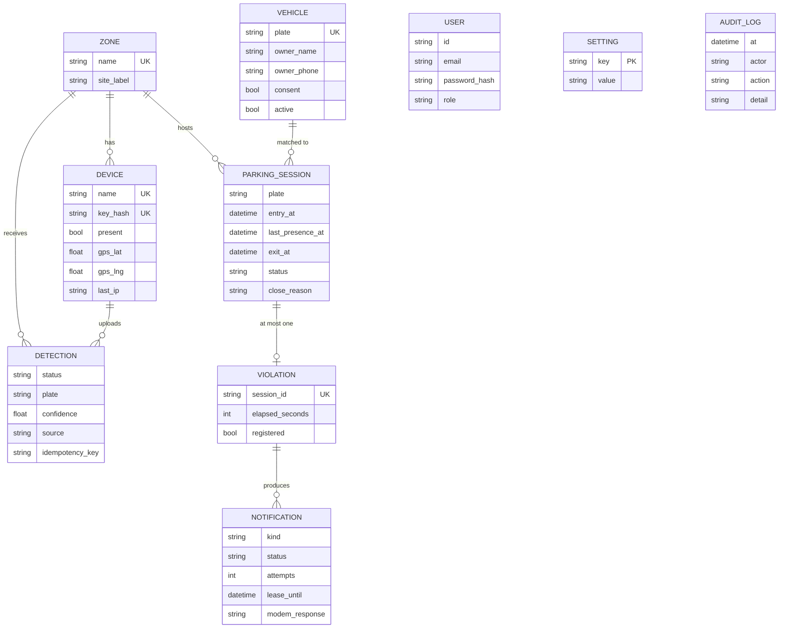

# 04 — Architecture and Data Model

## System overview

## Main flow
1. IR sees a vehicle → heartbeat `present=true`.
2. Backend replies `capture_needed` → unit uploads a JPEG → Detection `PENDING_ANPR`.
3. ANPR tick reads the plate → confirmed (≥ 0.75) or `NEEDS_REVIEW`.
4. Confirmed plate → ParkingSession ACTIVE (one per zone).
5. Violation tick: elapsed > threshold → Violation + Notifications (owner / admin / dashboard).
6. Unit polls `commands/lease` → sends the SMS through the SIM800L → `ack` (SUBMITTED / failure).
7. Presence stale > 60 s → session CLOSED (EXITED).

## Notification status machine
PENDING → LEASED → SUBMITTED → DELIVERED (not yet reported by the modem; reserved)
LEASED → RETRYING (retryable failure, backoff) → PENDING; LEASED + lease expiry → UNCERTAIN (never auto-resent); terminal: FAILED, CANCELLED, SHOWN (dashboard alert).

## Entity relationships

## Integrity rules enforced by the database
- `uq_active_session_zone`: partial unique index → one ACTIVE session per zone.
- `violations.session_id` unique → one violation per session.
- `uq_notification_once` → one notification per kind per violation.
- `devices.key_hash`, `vehicles.plate`, `zones.name` unique.

## Component notes
| Part | Tech |
|---|---|
| Backend | FastAPI, SQLAlchemy 2, SQLite (WAL), Pydantic v2, APScheduler, httpx |
| Auth | JWT (HS256) for the dashboard; `X-Device-Key` (sha256-hashed) for units |
| ANPR | RapidOCR (onnxruntime), 3 preprocessing variants, Indian plate rules |
| Dashboard | single static HTML + vanilla JS, polls every 5 s (no build step; documented deviation) |
| Firmware | Arduino C++ (esp32 core 3.3.7), non-blocking SIM800L state machine, OTA, local web UI |

## Device API
`POST /api/v1/device/heartbeat | presence | capture | commands/lease | commands/{id}/ack`. The admin API is listed interactively at `http://localhost:8000/docs`.
